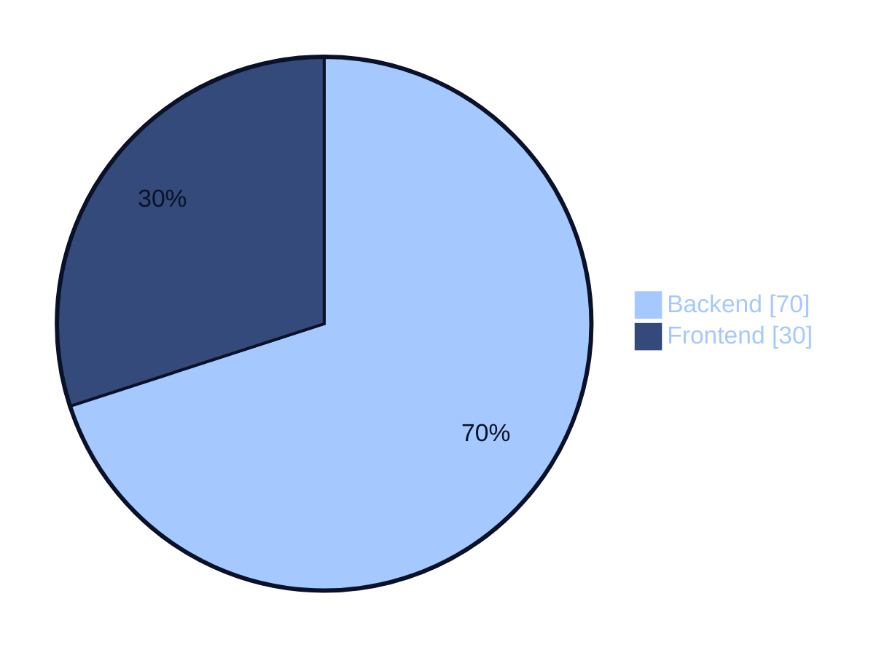

<div align="center">


<a href="https://daffaabrar.vercel.app/">
  
</a>

<br/><br/>

<a href="https://daffaabrar.vercel.app/"></a>
<a href="https://daffaabrar.vercel.app/cv-daffa-abrar.pdf"></a>
<a href="https://www.linkedin.com/in/daffa-abrar-77bb29323/"></a>
<a href="mailto:daffaabrar630@gmail.com"></a>

<br/><br/>


</div>

<br/>

### `01` &nbsp;TENTANG SAYA

> **Halo, saya Daffa Abrar** 👋

Formula harian saya: **70% backend, 30% frontend**, bantuan prompt AI pas logic mulai buntu, dan sisanya ahli memanfaatkan waktu rebahan secara maksimal.

Sebagai penikmat software development, saya lebih betah ngurusin **arsitektur data dan alur sistem** di belakang layar, tapi tetap memastikan visualnya clean dan enak dilihat.

```text
BERBASIS DI   Kecamatan Tilatang Kamang, Kabupaten Agam, Sumatera Barat, Indonesia
KULIAH        Politeknik Negeri Padang · Sistem Informasi · 2024 – sekarang
DI LUAR KULIAH  Bermain game · beberapa olahraga
```

<br/>

### `02` &nbsp;PORSI NGODING



<br/>

### `03` &nbsp;TECH STACK

**BACKEND** &nbsp;<sub>utama</sub>


**FRONTEND** &nbsp;<sub>secukupnya</sub>


**LAINNYA**


<br/>

### `04` &nbsp;DEVELOPER LOGS

| № | PROJECT | DESKRIPSI | TECH | STATUS |
|:-:|:--|:--|:--|:--|
| `01` | [**KostHub**](https://github.com/ZEY00-ai/KostHub) | Sistem pengelolaan kost di suatu wilayah/daerah | `Laravel` `MySQL` `Vue` | Pribadi · 2026 · 🔧 On-going |
| `02` | [**umkm.in**](https://github.com/ZEY00-ai/UMKM.in) | Pengelolaan beberapa UMKM dengan kasir dan owner dalam 1 akun | `Laravel` `MySQL` `Flutter` | Pribadi · 2026 · 🔧 On-going |
| `03` | [**SIG**](https://github.com/ZEY00-ai/PBL) | Sistem pemetaan sekolah di Tanah Datar | `CI4` `MySQL` | Kuliah · 2025 · ✅ Selesai |
| `04` | [**OMDB**](https://github.com/ZEY00-ai/OMDB_2A) | Sistem pencarian film berdasarkan OMDb | `Laravel` `MySQL` | Kuliah · 2025 · ✅ Selesai |

<br/>

### `05` &nbsp;LANGKAH SELANJUTNYA

Selalu senang diajak diskusi pengerjaan project, atau sekadar sharing. Kirim pesan aja ya!

<div align="center">

<a href="mailto:daffaabrar630@gmail.com"></a>
<a href="https://www.linkedin.com/in/daffa-abrar-77bb29323/"></a>
<a href="https://daffaabrar.vercel.app/"></a>

<br/><br/>


</div>
