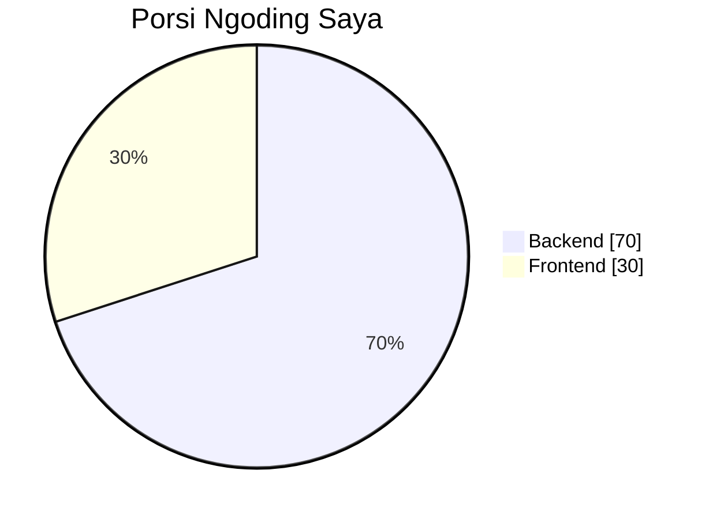

<div align="center">


<a href="https://daffaabrar.vercel.app/">
  
</a>

<br/><br/>

<a href="https://daffaabrar.vercel.app/"></a>
<a href="https://www.linkedin.com/in/daffa-abrar-77bb29323/"></a>
<a href="mailto:daffaabrar630@gmail.com"></a>

<br/>


</div>

<br/>

## 👨‍💻 Tentang Saya

```php
<?php

final class DaffaAbrar
{
    public const ROLE    = 'Mahasiswa Sistem Informasi & Web Developer';
    public const KAMPUS  = 'Politeknik Negeri Padang (2024 – sekarang)';
    public const LOKASI  = 'Agam, Sumatera Barat 🇮🇩';

    public array $formulaHarian = [
        'backend'   => '70%',
        'frontend'  => '30%',
        'ai_bantu'  => 'pas logic mulai buntu 🤖',
        'rebahan'   => 'dimanfaatkan secara maksimal 😴',
    ];

    public function fokus(): string
    {
        return 'Arsitektur data & alur sistem di balik layar, '
             . 'tapi visualnya tetap clean dan enak dilihat.';
    }
}
```

<br/>

## ⚖️ Komposisi Kerja



<div align="center">

| Sisi | Porsi | Bar |
|:--|:--:|:--|
| 🛠️ **Backend** | **70%** | `██████████████░░░░░░` |
| 🎨 **Frontend** | **30%** | `██████░░░░░░░░░░░░░░` |

</div>

<br/>

## 🧰 Tech Stack

### ⚙️ Backend &nbsp;<sub>(utama)</sub>

<p>
  
  
</p>

### 🎨 Frontend &nbsp;<sub>(secukupnya)</sub>

<p>
  
  
</p>

### 📱 Lainnya

<p>
  
</p>

<br/>

## 🚀 Proyek Pilihan

<table>
  <tr>
    <td width="50%" valign="top">
      <h3>🏠 <a href="https://github.com/ZEY00-ai/KostHub">KostHub</a></h3>
      <p>Sistem pengelolaan kost di suatu wilayah/daerah.</p>
      
      
      
      <br/><sub>🔧 Pribadi · 2026 · On-going</sub>
    </td>
    <td width="50%" valign="top">
      <h3>🛒 <a href="https://github.com/ZEY00-ai/UMKM.in">UMKM.in</a></h3>
      <p>Pengelolaan beberapa UMKM dengan kasir dan owner dalam satu akun.</p>
      
      
      
      <br/><sub>🔧 Pribadi · 2026 · On-going</sub>
    </td>
  </tr>
  <tr>
    <td width="50%" valign="top">
      <h3>🗺️ <a href="https://github.com/ZEY00-ai/PBL">SIG Pemetaan Sekolah</a></h3>
      <p>Sistem pemetaan sekolah di Kabupaten Tanah Datar.</p>
      
      
      <br/><sub>🎓 Kuliah · 2025 · Selesai</sub>
    </td>
    <td width="50%" valign="top">
      <h3>🎬 <a href="https://github.com/ZEY00-ai/OMDB_2A">OMDB</a></h3>
      <p>Sistem pencarian film berdasarkan OMDb API.</p>
      
      
      <br/><sub>🎓 Kuliah · 2025 · Selesai</sub>
    </td>
  </tr>
</table>

<br/>

## 🎮 Di Luar Ngoding

- 🎮 Bermain game
- ⚽ Beberapa olahraga
- 🎓 Lagi fokus kuliah sambil bangun proyek pribadi

<br/>

## 📫 Mari Terhubung

Selalu senang diajak diskusi pengerjaan proyek, atau sekadar sharing. Kirim pesan aja ya!

<div align="center">

[](https://daffaabrar.vercel.app/)
[](https://www.linkedin.com/in/daffa-abrar-77bb29323/)
[](mailto:daffaabrar630@gmail.com)

<br/>


</div>
